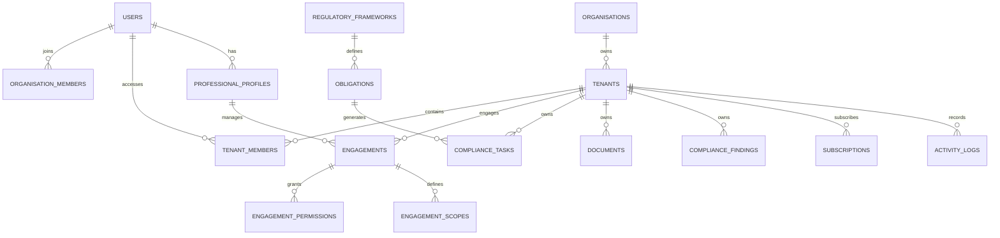
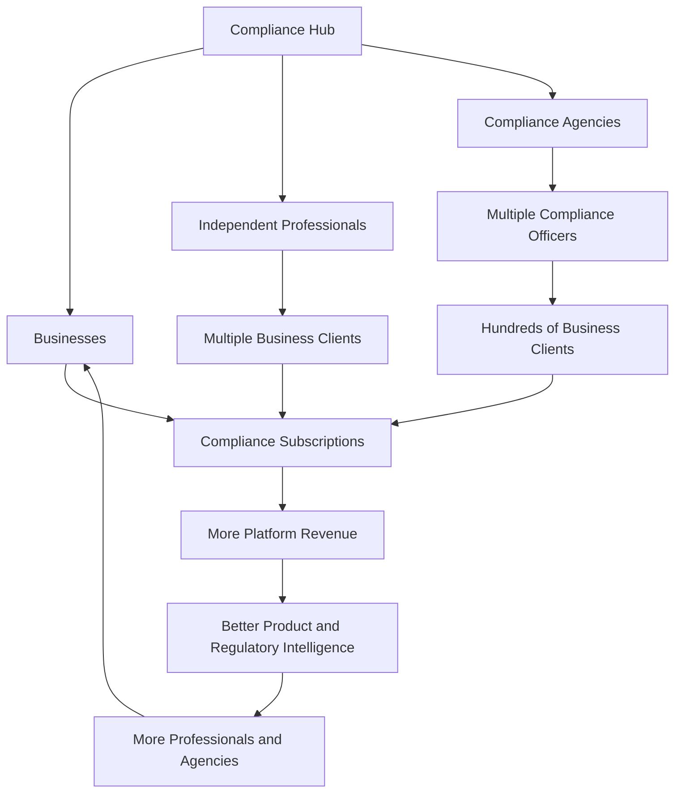

Hmm, that's a lot to put together properly. Lemme map it out cleanly.

# COMPLIANCE HUB.NG
## Master Product Blueprint, Business Plan & Technical Architecture

**Product vision:** Nigeria's integrated compliance management, professional services and compliance workforce platform.

**Market:** Nigeria, initially; West Africa subsequently.

**Business model:** B2B SaaS + professional marketplace + compliance practice management + enterprise services.

**Primary customers:**
1. Nigerian businesses and SMEs.
2. Compliance officers and independent consultants.
3. Compliance consulting firms and professional agencies.
4. Corporates and regulated institutions.
5. Accountants, lawyers and other compliance-adjacent professionals.

---

# PART 1 — THE BUSINESS CONCEPT

## 1.1 What exactly are we building?

I would not build Compliance Hub as just another compliance application.

I would build a platform that connects three things:

- Businesses that have compliance obligations.
- Professionals who understand and manage those obligations.
- Technology that helps both parties execute, monitor and document compliance activities.

The underlying problem is that compliance is fragmented.

A business might need:
- An accountant to handle tax obligations.
- A lawyer to handle corporate documentation.
- A compliance officer to manage regulatory requirements.
- A data protection professional.
- An AML specialist.
- An auditor.
- An HR professional to manage employee certifications.

These professionals often work independently, use separate tools and maintain separate records.

Compliance Hub brings these activities together.

### Our positioning

**Compliance Hub — Everything compliance. One workspace.**

A business should be able to come to Compliance Hub and answer five questions:

1. What compliance obligations apply to my business?
2. What do I need to do?
3. Who can help me do it?
4. Is everything being done correctly and on time?
5. Can I produce evidence that demonstrates compliance?

This gives us a much stronger proposition than simply selling compliance reminders.

## 1.2 The four interconnected products

I recommend four primary product environments.

| Product | Primary user | Purpose |
|---|---|---|
| HubBusiness | Businesses | Manage company compliance |
| HubExperts | Compliance professionals | Discover clients and offer services |
| HubAgents | Compliance officers and agencies | Manage multiple business accounts |
| HubEnterprise | Corporates and large organisations | Manage complex compliance operations |

These are not four disconnected applications.

They share one underlying platform, identity system, permission engine, billing infrastructure and compliance data architecture.

A user may belong to multiple environments.

For example, a compliance officer could have:
- A personal professional account.
- An agency account.
- Access to 15 client businesses.
- Their own business workspace.

They should be able to switch between these contexts without maintaining separate logins.

---

# PART 2 — PRODUCT ARCHITECTURE

## 2.1 The twelve compliance modules

We retain the original twelve-module concept, with one important distinction: HubExperts and HubAgents are platform environments, not additions to the twelve compliance modules.

| No. | Module | Primary function |
|---:|---|---|
| 1 | HubCalendar | Regulatory deadlines and compliance calendars |
| 2 | HubDocs | Document collection, storage and expiry tracking |
| 3 | HubPeople | Employee compliance and certification management |
| 4 | HubVendors | Vendor onboarding and compliance management |
| 5 | HubAudit | Internal audits and audit preparation |
| 6 | HubAML | AML/CFT, KYC and risk management workflows |
| 7 | HubPrivacy | Data protection and privacy management |
| 8 | HubAcademy | Compliance training and certification |
| 9 | HubDue | Vendor due diligence and risk assessments |
| 10 | HubNotify | WhatsApp, SMS and email communications |
| 11 | HubReport | Compliance reports and evidence packages |
| 12 | HubAlerts | Urgent compliance notifications |

HubAnalytics and HubSupport remain shared platform capabilities.

### How the modules work together

Consider a fintech business.

It registers on Compliance Hub.

HubCalendar identifies its upcoming compliance obligations.

HubDocs identifies missing corporate and regulatory documents.

HubPeople identifies employees who need compliance training.

HubAML manages relevant customer due diligence and AML workflows.

HubPrivacy manages its data protection programme.

HubAudit tracks internal assessments and outstanding findings.

HubReport produces an evidence package.

If the business doesn't have an internal compliance officer, it can engage one through HubExperts.

That officer manages the business through HubAgents.

This is the central product experience.

---

# PART 3 — THE APPLICATIONS AND SCREENS

I would use one responsive web platform initially, with distinct dashboards based on account type.

We do not need to build four independent frontend projects at launch.

We need one application with clearly separated environments.

## 3.1 Public website — ComplianceHub.ng

The public website is our acquisition and conversion engine.

**Screens:**

| Screen | Purpose |
|---|---|
| Home | Explain the platform |
| Solutions | Explain business and professional solutions |
| Modules | Showcase the twelve modules |
| Industries | Industry-specific compliance solutions |
| Find an Expert | Professional marketplace |
| Hire a Compliance Officer | Recruitment and engagement |
| Become an Expert | Professional registration |
| Pricing | Subscription plans |
| Resources | Regulatory guides and educational content |
| About | Company information |
| Contact | Enquiries and support |
| Login | Authentication |
| Register | Account creation |

### Homepage structure

I would use this arrangement:

1. Hero section: Everything compliance. One workspace.
2. CTA: Get started / Find a compliance expert.
3. Three customer segments: Businesses, professionals and agencies.
4. Compliance modules.
5. How it works.
6. Professional marketplace.
7. Industry solutions.
8. Pricing.
9. Educational resources.
10. Final registration CTA.

We should avoid making the homepage look like a legal consultancy website.

It should look like a modern business software platform.

---

## 3.2 HubBusiness — Business dashboard

This is the environment businesses see after registration.

### Screen 1: Business onboarding

The onboarding process should be intelligent.

**Step 1: Create business profile**

- Business name.
- CAC registration number, where applicable.
- Business type.
- Industry.
- State of operation.
- Number of employees.
- Number of locations.
- Contact details.

**Step 2: Business classification**

Ask questions that help identify relevant compliance obligations.

Examples:
- Do you employ staff?
- Do you collect customer personal information?
- Do you process payments?
- Do you operate in financial services?
- Are you a DNFBP?
- Do you engage vendors?
- Do you operate multiple branches?

**Step 3: Compliance assessment**

The platform generates an initial compliance profile.

**Step 4: Select services**

The customer can:
- Manage compliance independently.
- Hire a compliance professional.
- Engage a consulting agency.
- Subscribe to individual modules.

**Step 5: Dashboard creation**

The business enters its workspace.

Importantly, onboarding questions should not be treated as definitive legal determinations. The platform should identify potential obligations and indicate when professional verification is needed.

### Screen 2: Business dashboard

This is the most important screen in the entire product.

I would structure it as follows:

**Top navigation**
- Business name.
- Workspace selector.
- Notifications.
- Help.
- Profile.

**Main dashboard**

| Dashboard component | Information displayed |
|---|---|
| Compliance score | Overall internal readiness indicator |
| Upcoming deadlines | Obligations approaching their due dates |
| Outstanding tasks | Incomplete compliance activities |
| Missing documents | Required evidence not yet uploaded |
| Active professionals | People managing compliance |
| Risk indicators | Outstanding high-priority issues |
| Recent activities | Actions taken in the workspace |

The compliance score must be transparent and explainable.

It should not imply official regulatory certification.

### Screen 3: Compliance overview

A consolidated view of:
- Applicable obligations.
- Completed obligations.
- Overdue obligations.
- Pending reviews.
- Evidence availability.
- Responsible persons.

### Screen 4: My professionals

Businesses should see everyone who has access to their workspace.

| Professional | Specialisation | Access | Status |
|---|---|---|---|
| John A. | AML | HubAML | Active |
| Mary B. | Data protection | HubPrivacy | Active |
| ABC Consulting | Corporate compliance | Multiple modules | Active |

Actions:
- View profile.
- View engagement.
- Change permissions.
- Suspend access.
- Revoke access.
- Renew engagement.

### Screen 5: Business documents

Document folders:
- Corporate documents.
- Tax documents.
- Employee documents.
- Vendor documents.
- AML/KYC records.
- Data protection records.
- Audit evidence.
- Licences and permits.

Each document should have:
- Document name.
- Category.
- Upload date.
- Expiry date.
- Owner.
- Access classification.
- Verification status.
- Version history.

### Screen 6: Compliance calendar

Calendar views:
- Monthly.
- Weekly.
- List.
- Regulatory deadlines.
- Internal deadlines.

Each event should identify:
- Obligation.
- Regulatory source.
- Applicable jurisdiction.
- Due date.
- Responsible person.
- Completion status.
- Evidence required.

### Screen 7: Tasks and approvals

The business can assign tasks to:
- Employees.
- Compliance officers.
- External consultants.
- Agency members.

A task moves through:

Created → Assigned → In progress → Submitted for review → Approved or rejected → Completed.

### Screen 8: Reports

Download:
- Compliance status report.
- Outstanding obligations report.
- Document register.
- Employee training report.
- Vendor compliance report.
- Audit findings report.
- Professional activity report.

---

## 3.3 HubExperts — Professional marketplace

This is our talent acquisition and professional services environment.

### Professional registration

Professionals register using:
- Full name.
- Email.
- Phone number.
- Location.
- Professional qualifications.
- Years of experience.
- Areas of specialisation.
- Professional memberships.
- Employment history.
- Certifications.
- Portfolio.

Additional verification should be required for regulated or specialist services.

A professional's claimed qualification must not automatically be treated as verified.

### Professional marketplace screens

| Screen | Function |
|---|---|
| Expert directory | Search professionals |
| Professional profile | Qualifications and experience |
| Specialisation | Areas of expertise |
| Availability | Working availability |
| Engagement options | Full-time, fractional or project-based |
| Reviews | Verified client feedback |
| Request consultation | Initiate engagement |
| Post a vacancy | Recruit permanent employees |
| My applications | Track applications |
| My engagements | Manage active contracts |

### Three engagement categories

**1. Permanent recruitment**

A business posts a vacancy.

Professionals apply.

The business shortlists candidates, interviews them and hires independently or through an agreed recruitment arrangement.

**2. Fractional compliance officers**

Businesses engage professionals on:
- Monthly retainers.
- Weekly hours.
- Defined responsibilities.
- Fixed engagement periods.

**3. Project-based consulting**

Businesses request:
- Compliance assessments.
- AML policy development.
- Data protection assessments.
- Internal audits.
- Documentation reviews.
- Regulatory readiness reviews.

We should distinguish recruitment placements from independent professional engagements because their commercial terms and legal responsibilities differ.

---

## 3.4 HubAgents — Compliance practice management

This is arguably the most strategically important environment.

It allows compliance professionals to manage several businesses simultaneously.

### Screen 1: Professional dashboard

Display:

| Metric | Example |
|---|---:|
| Active clients | 24 |
| Outstanding tasks | 37 |
| Upcoming deadlines | 12 |
| Pending approvals | 8 |
| High-risk issues | 3 |
| Active engagements | 21 |

### Screen 2: Client portfolio

A professional sees all assigned businesses.

Filters:
- Industry.
- Compliance status.
- Engagement type.
- Assigned officer.
- Upcoming deadlines.
- Risk level.

### Screen 3: Client workspace

When an officer selects a business, they enter its authorised workspace.

They can access only the modules and records granted to them.

### Screen 4: Work management

The professional sees:
- Assigned tasks.
- Tasks awaiting approval.
- Pending documents.
- Upcoming deadlines.
- Audit findings.
- Client messages.

### Screen 5: Engagement management

Each client relationship contains:

- Contract.
- Scope of work.
- Fee.
- Duration.
- Assigned professional.
- Authorised modules.
- Access permissions.
- Service-level expectations.
- Renewal date.
- Termination conditions.

### Screen 6: Client communication

A built-in communication centre should support:
- Business messaging.
- Document requests.
- Task comments.
- Notifications.
- Meeting requests.
- Engagement updates.

### Screen 7: Professional performance

Reports should include:
- Number of clients managed.
- Tasks completed.
- Average completion time.
- Outstanding client requests.
- Compliance issues resolved.
- Client satisfaction.

This makes Compliance Hub useful even to established compliance consulting firms.

---

## 3.5 HubAgency — Agency administration

I would make agency accounts a specialised extension of HubAgents.

An agency can register its firm and onboard its employees.

Agency roles:

| Role | Responsibilities |
|---|---|
| Agency owner | Controls agency account |
| Agency administrator | Manages users and clients |
| Senior compliance officer | Supervises engagements |
| Compliance officer | Manages assigned clients |
| Auditor | Reviews evidence and findings |
| Finance officer | Handles billing and payments |

Agency dashboard:

- Total clients.
- Active engagements.
- Assigned employees.
- Outstanding tasks.
- Revenue.
- Client renewals.
- Staff utilisation.
- Client risk overview.

An agency administrator should not automatically receive access to every sensitive client record. Agency access and client permissions must be separately controlled.

---

## 3.6 HubEnterprise

This is the corporate version.

Additional features:
- Multiple subsidiaries.
- Multiple business locations.
- Department-level access.
- Centralised reporting.
- Custom approval hierarchies.
- SSO.
- API integrations.
- Audit exports.
- Custom regulatory frameworks.
- Dedicated account management.

I would not build all enterprise capabilities in V1.

However, the architecture should not prevent us from adding them.

---

# PART 4 — USER FLOWS

These are the primary end-to-end journeys.

## Flow A: A business registers and manages compliance independently

```text
Visit ComplianceHub.ng
        |
     Register
        |
 Create Business
        |
 Enter Business Details
        |
 Business Classification
        |
 Compliance Assessment
        |
 Generate Initial Obligations
        |
   Business Dashboard
        |
 Select Modules
        |
 Upload Documents
        |
 Assign Internal Tasks
        |
 Track Compliance
        |
 Generate Reports
```

Commercial conversion occurs during module selection and when the business encounters a need it cannot manage internally.

## Flow B: A business hires a compliance officer

```text
Business Dashboard
        |
   My Professionals
        |
  Find an Expert
        |
 Search Professionals
        |
 View Professional Profile
        |
 Request Engagement
        |
 Define Scope and Fee
        |
 Professional Accepts
        |
 Business Approves
        |
 Create Engagement
        |
 Grant Permissions
        |
 Officer Accesses Workspace
        |
 Officer Manages Compliance
        |
 Business Reviews Activities
```

The business retains control over access.

## Flow C: A compliance officer acquires a client

```text
Professional Registration
        |
 Verification
        |
 Professional Dashboard
        |
 Discover Businesses
        |
 Respond to Opportunities
        |
 Business Accepts Proposal
        |
 Engagement Agreement
        |
 Business Grants Access
        |
 Client Appears in Portfolio
        |
 Manage Compliance
        |
 Submit Reports
        |
 Receive Payment
```

## Flow D: An agency manages 100 businesses

```text
Agency Registration
        |
 Verify Agency
        |
 Create Agency Workspace
        |
 Invite Employees
        |
 Assign Roles
        |
 Acquire Business Clients
        |
 Create Client Engagements
        |
 Assign Compliance Officers
        |
 Grant Client-Specific Access
        |
 Monitor Portfolio
        |
 Review Performance
        |
 Bill Clients
```

## Flow E: A business needs a specialist

```text
Compliance Assessment
        |
 Identify Missing Capability
        |
 Recommend Specialist
        |
 Search HubExperts
        |
 Select Professional
        |
 Agree Engagement
        |
 Specialist Completes Assignment
        |
 Upload Evidence
        |
 Business Approves
        |
 Close Assignment
```

## Flow F: Professional access is revoked

```text
Business Administrator
        |
 Open My Professionals
        |
 Select Professional
        |
 Revoke Access
        |
 Permission Engine Invalidates Access
        |
 Active Sessions Terminated
        |
 API Requests Denied
        |
 Preserve Activity History
        |
 Notify Professional
```

Revocation must take effect immediately, including on active sessions and API tokens.

---

# PART 5 — PERMISSIONS, SECURITY AND DATA OWNERSHIP

This is a foundational requirement, not something we add later.

We will be handling sensitive corporate records, employee information, identity documents, financial records and potentially regulated information.

## 5.1 Multi-tenant architecture

The fundamental rule:

**Every business owns an independent data workspace. Professionals receive delegated access, not ownership.**

Example:

```text
COMPLIANCE HUB
      |
      |--- Business A
      |       |--- Documents
      |       |--- Employees
      |       |--- Vendors
      |       |--- AML
      |       |--- Privacy
      |
      |--- Business B
      |       |--- Documents
      |       |--- Employees
      |       |--- Vendors
      |       |--- AML
      |       |--- Privacy
      |
      |--- Business C
              |--- Documents
              |--- Employees
              |--- Vendors
              |--- AML
              |--- Privacy
```

Now consider a professional managing all three businesses.

```text
PROFESSIONAL ACCOUNT
       |
       |--- Client A (Authorised)
       |
       |--- Client B (Authorised)
       |
       |--- Client C (Authorised)
```

The professional has access to three independent workspaces.

There must be no possibility of accidentally retrieving Business A's documents while operating within Business B.

## 5.2 Permission architecture

I recommend combining:

- Role-Based Access Control (RBAC).
- Attribute-Based Access Control (ABAC).
- Tenant-level isolation.
- Engagement-level permissions.
- Resource-level restrictions.

A permission should consider:

1. Who is making the request?
2. Which business does the resource belong to?
3. What is the user's relationship with that business?
4. Is the engagement active?
5. Is the requested module authorised?
6. Is the requested action permitted?
7. Is additional approval required?

Example:

A data protection consultant may:
- View privacy records.
- Upload assessment documents.
- Create remediation tasks.
- Review data processing agreements.

But may not:
- View employee payroll.
- Access AML customer records.
- Delete company records.
- Invite other professionals.

## 5.3 Essential security features

| Feature | Requirement |
|---|---|
| MFA | Mandatory for professionals and agency administrators |
| Encryption | At rest and in transit |
| Session management | Track and terminate active sessions |
| Audit trail | Record sensitive user actions |
| Document permissions | Control viewing and downloading |
| Access expiration | Automatically expire engagements |
| Access reviews | Periodically confirm professional permissions |
| Backup | Encrypted and regularly tested |
| Data export | Controlled by authorised business administrators |
| Account recovery | Secure recovery and identity verification |

Sensitive actions should support dual approval.

For example, an officer preparing a regulatory submission should not automatically be authorised to approve it on behalf of a company.

The platform should also distinguish between preparing a filing, submitting it and legally signing or certifying it.

## 5.4 Regulatory considerations

Three areas deserve special attention at launch.

**Data protection**

The Nigeria Data Protection Act 2023 and the NDPC's implementation framework create obligations around personal data processing, security, accountability and applicable compliance returns.

Our platform will itself process personal information, so Compliance Hub must implement privacy by design.

The NDPC framework also makes licensed Data Protection Compliance Organisations important partners for relevant audit and filing services. We should not present ordinary software-generated reports as substitutes for statutory professional services. [National Drug Law Enforcement Agency](https://www.ndpc.gov.ng/Files/NDP-GAID-DRAFT.pdf?utm_source=chatgpt.com)

**Tax compliance**

The Nigeria Tax Act 2025 and associated tax legislation commenced under the new framework from January 1, 2026.

Our regulatory intelligence team must maintain a versioned obligation database reflecting the new framework and its implementation guidance. [Federal Ministry of Finance](https://finance.gov.ng/ministry/federal-government-issues-transition-guidelines-for-tax-acts-2025/?utm_source=chatgpt.com)

**AML/CFT**

SCUML publishes obligations for applicable designated non-financial businesses and professions, including compliance officers, staff training, reporting, KYC/CDD and record keeping.

This gives HubAML a concrete initial workflow opportunity. However, applicability must be determined by the entity's actual classification and regulatory circumstances. [SCU AML](https://scuml.efcc.gov.ng/faqs/?utm_source=chatgpt.com)

We should engage Nigerian legal and regulatory specialists before releasing automated legal conclusions.

---

# PART 6 — DATABASE AND TECHNICAL SCHEMA

This is the foundation I would give the engineering team.

I recommend PostgreSQL as the primary relational database.

Redis can support caching, background queues and frequently accessed portfolio summaries.

Object storage should handle uploaded documents.

The architecture should initially be a modular monolith or a small number of well-defined services rather than prematurely introducing dozens of microservices.

## 6.1 Core database entities

### A. Identity and accounts

| Table | Purpose |
|---|---|
| users | All registered individuals |
| user_profiles | Personal information |
| user_credentials | Authentication information |
| user_sessions | Active sessions |
| user_mfa | MFA configuration |
| organisations | Registered businesses and agencies |
| organisation_members | Business membership |
| organisation_roles | Business role definitions |
| organisation_settings | Business configuration |
| professional_profiles | Professional details |
| agency_profiles | Agency details |
| agency_members | Agency employee relationships |

### B. Tenant management

| Table | Purpose |
|---|---|
| tenants | Independent business workspaces |
| tenant_members | Users authorised in each tenant |
| tenant_settings | Workspace configuration |
| tenant_subscriptions | Business subscriptions |
| tenant_modules | Enabled modules |
| tenant_domains | Custom domain configuration, if required |

An organisation may own one or more workspaces in the future.

For V1, I would support one primary workspace per registered business, while designing the schema to accommodate subsidiaries and branches later.

### C. Professional access

| Table | Purpose |
|---|---|
| professional_clients | Professional-to-client relationship |
| client_invitations | Access invitations |
| engagements | Contractual engagement records |
| engagement_scopes | Responsibilities and deliverables |
| engagement_permissions | Authorised modules and actions |
| access_grants | Explicit permission grants |
| access_reviews | Periodic permission reviews |
| professional_assignments | Staff-to-client assignments |
| agency_client_assignments | Agency client relationships |

### D. Compliance modules

| Table | Purpose |
|---|---|
| regulatory_bodies | CAC, NRS, NDPC, CBN, etc. |
| regulatory_frameworks | Applicable laws and frameworks |
| regulatory_sources | Official publications and references |
| regulatory_versions | Version history |
| obligations | Individual compliance obligations |
| obligation_applicability | Business applicability |
| compliance_tasks | Tasks generated from obligations |
| compliance_status | Current compliance state |
| compliance_evidence | Supporting evidence |
| compliance_findings | Identified gaps |
| remediation_actions | Corrective actions |

### E. Documents and records

| Table | Purpose |
|---|---|
| documents | Document metadata |
| document_versions | Version history |
| document_categories | Document classification |
| document_permissions | Access controls |
| document_requests | Requested documents |
| document_expiry | Expiry information |
| document_verifications | Verification records |

### F. People and vendors

| Table | Purpose |
|---|---|
| employees | Employee records |
| employee_certifications | Certifications |
| employee_training | Training history |
| vendors | Vendor profiles |
| vendor_documents | Vendor evidence |
| vendor_assessments | Vendor assessments |
| vendor_risk_scores | Vendor risk information |

### G. AML and privacy

| Table | Purpose |
|---|---|
| aml_cases | AML review cases |
| aml_customer_records | Relevant customer records |
| aml_risk_assessments | Risk assessments |
| aml_screening_results | Screening results |
| aml_escalations | Escalated issues |
| processing_activities | Data processing records |
| privacy_requests | Data subject requests |
| privacy_incidents | Data incidents |
| privacy_assessments | Privacy assessments |
| privacy_vendors | Data processors and vendors |
| data_transfer_records | Cross-border transfer records |

Sensitive AML and personal data tables should have stricter access controls and retention policies than ordinary company profile records.

### H. Marketplace and commercial transactions

| Table | Purpose |
|---|---|
| professional_services | Services offered |
| job_postings | Recruitment vacancies |
| applications | Professional applications |
| proposals | Professional proposals |
| marketplace_requests | Client service requests |
| engagement_deliverables | Contract deliverables |
| reviews | Verified reviews |
| invoices | Customer invoices |
| payments | Payment records |
| commissions | Platform fees |
| payouts | Professional payments |
| refunds | Refund records |

### I. Platform operations

| Table | Purpose |
|---|---|
| notifications | Notifications |
| notification_preferences | Delivery preferences |
| messages | Client-professional messaging |
| activity_logs | User activity |
| audit_logs | Security and compliance events |
| support_tickets | Support requests |
| subscriptions | Platform subscriptions |
| subscription_items | Module subscriptions |
| billing_events | Billing history |
| integration_connections | External integrations |
| webhook_events | Integration events |

## 6.2 Important database relationships



## 6.3 Critical database rule

Every business-owned record must contain a `tenant_id`.

For example:

```sql
CREATE TABLE documents (
    id UUID PRIMARY KEY,
    tenant_id UUID NOT NULL,
    uploaded_by UUID NOT NULL,
    document_name VARCHAR(255) NOT NULL,
    document_category VARCHAR(100),
    storage_key TEXT NOT NULL,
    classification VARCHAR(50),
    expiry_date DATE,
    verification_status VARCHAR(50),
    created_at TIMESTAMPTZ DEFAULT NOW()
);
```

We should enforce tenant isolation using PostgreSQL Row-Level Security where appropriate, backed by application-level authorisation.

Never rely on a frontend tenant ID or a URL parameter as proof of access.

## 6.4 Recommended backend services

I would start with these bounded modules:

| Service | Responsibilities |
|---|---|
| Identity Service | Authentication and user accounts |
| Organisation Service | Businesses and agencies |
| Tenant Service | Workspace isolation |
| Permission Service | Roles and delegated access |
| Engagement Service | Contracts and assignments |
| Compliance Engine | Regulatory obligations and tasks |
| Document Service | Storage and evidence |
| Marketplace Service | Professionals and recruitment |
| Billing Service | Plans, invoices and payments |
| Notification Service | SMS, email and WhatsApp |
| Reporting Service | Reports and analytics |
| Audit Service | Immutable activity records |

These can initially run inside a modular backend with clear internal boundaries.

Extract services as usage and engineering requirements justify it.

## 6.5 API architecture

Suggested API groups:

```text
/api/v1/auth
/api/v1/users
/api/v1/organisations
/api/v1/tenants
/api/v1/businesses

/api/v1/professionals
/api/v1/agencies
/api/v1/clients
/api/v1/engagements
/api/v1/access-grants

/api/v1/calendar
/api/v1/documents
/api/v1/people
/api/v1/vendors
/api/v1/audits
/api/v1/aml
/api/v1/privacy
/api/v1/academy
/api/v1/due-diligence
/api/v1/notifications
/api/v1/reports
/api/v1/alerts

/api/v1/subscriptions
/api/v1/payments
/api/v1/invoices

/api/v1/audit-logs
/api/v1/integrations
```

Every endpoint that accesses business information must pass through tenant resolution and authorisation middleware.

---

# PART 7 — REGULATORY INTELLIGENCE ENGINE

This is where Compliance Hub can develop a meaningful competitive advantage.

We should not simply create a collection of reminders.

We should create a structured database of Nigerian regulatory obligations.

## 7.1 Regulatory source hierarchy

The system should distinguish between:

1. Acts of the National Assembly.
2. Regulations and statutory instruments.
3. Official regulatory circulars.
4. Official implementation guidelines.
5. Regulatory notices.
6. Professional guidance.
7. Internal interpretations and recommendations.

Each obligation should contain:

| Field | Description |
|---|---|
| Obligation ID | Unique identifier |
| Regulatory authority | Relevant authority |
| Framework | Applicable legislation |
| Source URL | Original publication |
| Source version | Publication/version reference |
| Effective date | When the requirement applies |
| Applicable entities | Who must comply |
| Obligation description | What must be done |
| Deadline | When it must be done |
| Frequency | Annual, monthly, event-based, etc. |
| Required evidence | What demonstrates completion |
| Responsible role | Who should manage it |
| Penalty reference | Verified consequence, where available |
| Review status | Verified, under review or superseded |

## 7.2 The intelligence workflow

```text
Regulatory Publication
        |
 Regulatory Research
        |
 Identify New Requirement
        |
 Legal/Compliance Review
        |
 Create Structured Obligation
        |
 Approve Publication
        |
 Match Applicable Businesses
        |
 Generate Compliance Tasks
        |
 Notify Responsible Users
        |
 Track Completion
        |
 Preserve Evidence
```

An AI assistant can help identify changes, summarise documents and draft workflows.

However, AI must not autonomously publish unverified legal interpretations.

Every published obligation needs an accountable reviewer, source reference and version history.

## 7.3 The compliance recommendation engine

A business profile is matched against the obligations database.

For example:

```text
BUSINESS PROFILE

Industry: Financial Technology
Employees: 35
Customers: 12,000
Processes personal data: Yes
Processes payments: Yes
Third-party vendors: 18

             |
             V

COMPLIANCE CLASSIFICATION

Potential AML obligations
Potential data protection obligations
Tax obligations
Employment-related obligations
Vendor management requirements
Corporate obligations

             |
             V

PERSONALISED COMPLIANCE WORKSPACE
```

The platform should explain why an obligation was identified and allow a qualified reviewer to confirm or reject applicability.

This is much more valuable than a generic compliance checklist.

---

# PART 8 — GO-TO-MARKET STRATEGY

My recommendation is to avoid launching all twelve modules to all Nigerian businesses simultaneously.

We should build the complete architecture but commercialise the product in stages.

## 8.1 Initial target markets

I would prioritise five customer segments.

| Priority | Customer segment | Main pain point |
|---|---|---|
| 1 | Compliance consultants and agencies | Managing multiple clients |
| 2 | SMEs and growing businesses | Managing recurring obligations |
| 3 | Fintechs and financial services | AML, KYC and regulatory oversight |
| 4 | DNFBPs and professional firms | SCUML and applicable AML obligations |
| 5 | Medium and large corporates | Vendor, employee and enterprise compliance |

An important strategic decision:

**I would actually consider launching the professional practice platform before the full business SaaS suite.**

Why?

Because one professional can introduce us to multiple businesses.

Instead of acquiring 100 businesses individually, we could acquire 10 compliance professionals, each managing 10 clients.

That creates a potentially cheaper distribution channel.

However, we must validate that professionals are willing to adopt another practice-management tool and that their clients will authorise its use.

## 8.2 Initial customer acquisition strategy

### Channel A: Professional recruitment

Recruit:
- Independent compliance officers.
- Tax consultants.
- AML specialists.
- Data protection consultants.
- Compliance agencies.

Offer founding professionals:
- Free onboarding.
- Discounted first-year subscriptions.
- Professional profiles.
- Client management tools.
- Early access to marketplace opportunities.

The objective is to build a credible supply network.

### Channel B: Professional associations

Build relationships with:
- Compliance and risk management associations.
- Accounting professional bodies.
- Legal professional networks.
- Data protection professional communities.
- Relevant industry associations.

We should pursue partnerships rather than imply endorsement by any association.

### Channel C: SME acquisition

Content marketing should target practical questions.

Examples:
- What compliance obligations does a Nigerian SME have?
- What happens if your CAC annual returns are overdue?
- Does your business need a compliance officer?
- What are your NDPC obligations?
- What records should you maintain for an audit?
- What does SCUML expect from applicable businesses?

Every article should lead to a practical assessment or product registration.

### Channel D: Direct corporate sales

Target:
- Fintechs.
- Logistics businesses.
- Schools and educational companies.
- Manufacturers.
- Healthcare operators.
- Professional services firms.

Sell the platform as a means of centralising compliance management.

### Channel E: Referral programme

Professionals can refer business clients.

Businesses can refer other businesses.

Agencies can introduce their entire client portfolios.

The referral programme should reward genuine paid conversions, not simply registrations.

---

## 8.3 The first 100 customers

I would structure the initial acquisition target as follows.

| Channel | Target |
|---|---:|
| Compliance professionals introducing clients | 35 |
| Direct SME acquisition | 25 |
| Compliance agencies | 15 |
| Fintech and corporate pilots | 10 |
| Professional association referrals | 10 |
| Content and organic acquisition | 5 |
| **Total** | **100** |

These are proposed acquisition targets, not market forecasts.

The goal is to learn which channel produces the best retention and customer acquisition economics.

## 8.4 Competitive positioning

We have existing competition.

For example:

| Competitor | Main focus | Our opportunity |
|---|---|---|
| Asiri | Data protection compliance | Broader compliance management and professional practice workflows |
| GRCNaija | GRC and regulatory intelligence | Business operations and professional collaboration |
| Prembly | KYC, KYB and identity verification | Integrate verification infrastructure |
| Dojah | Identity and AML technology | Integrate specialist APIs |
| KoboDocs | Payroll, documents and business tools | Cross-functional compliance workspace |
| Taxaide | Tax and advisory services | Partner for specialist tax services |

Asiri is especially important to study.

Its current public pricing includes:
- Free Record.
- ₦49,000 annually for Foundation.
- ₦149,000 annually for Evidence.
- ₦299,000 annually for Assurance.

It also describes workflows around evidence, assessments, vendor records and DPCO collaboration.

This confirms that privacy compliance software already has a Nigerian market presence. It also gives us a pricing reference, not proof of what customers will pay for our broader product. [Asiri](https://asiri.ng/?utm_source=chatgpt.com)

Our differentiation should be:

**Compliance software + professional marketplace + practice management + delegated business access.**

We should not attempt to recreate Prembly or Dojah's identity verification infrastructure.

We should integrate with suitable providers.

---

# PART 9 — PRICING AND REVENUE MODEL

I recommend five revenue streams.

1. Business subscriptions.
2. Professional subscriptions.
3. Agency subscriptions.
4. Marketplace transaction fees.
5. Enterprise contracts and implementation services.

## 9.1 Business subscriptions

Initial pricing hypothesis:

| Plan | Monthly price | Target customer |
|---|---:|---|
| Free | ₦0 | Microbusinesses testing the platform |
| Starter | ₦7,500 | Small businesses |
| Business | ₦20,000 | Growing SMEs |
| Professional | ₦45,000 | Businesses with complex needs |
| Enterprise | Custom | Corporates |

### Starter

- One business workspace.
- Basic compliance calendar.
- Document management.
- Basic reminders.
- Limited compliance tasks.
- One administrator.

### Business

Everything in Starter, plus:
- Multiple employees.
- Vendor records.
- Professional access.
- Compliance reports.
- Multiple modules.
- Task management.

### Professional

Everything in Business, plus:
- Advanced AML workflows where applicable.
- Privacy management.
- Audit preparation.
- Advanced reporting.
- Multiple professional engagements.
- Advanced permissions.

Enterprise receives custom integrations, consolidated reporting and additional governance features.

## 9.2 Professional subscriptions

Professionals need their own subscription.

| Plan | Monthly price | Intended user |
|---|---:|---|
| Free | ₦0 | New professionals |
| Independent | ₦10,000 | Individual consultants |
| Practice | ₦25,000 | Professionals managing multiple clients |
| Professional Plus | ₦50,000 | Established practitioners |

Possible client limits:

- Free: 2 active clients.
- Independent: 10 active clients.
- Practice: 30 active clients.
- Professional Plus: 75 active clients.

These are initial commercial assumptions.

Additional client capacity can be sold as an add-on.

## 9.3 Agency subscriptions

| Plan | Monthly price | Target capacity |
|---|---:|---|
| Agency Starter | ₦75,000 | Small practice |
| Agency Growth | ₦150,000 | Growing consultancy |
| Agency Enterprise | Custom | Large compliance firms |

Pricing should reflect employee seats, client capacity, storage, integrations and support.

## 9.4 Marketplace revenue

For professional engagements, I would initially charge:

- 8–12% of completed project engagements.
- A fixed recruitment placement fee for permanent hires.
- Optional payment processing charges where applicable.

I would not charge professionals to submit every proposal at launch.

We need to attract quality professionals first.

The marketplace should also offer direct contracting for businesses that prefer to manage payments outside the platform, subject to our commercial terms.

---

# PART 10 — FINANCIAL MODEL AND PROFITABILITY

We need to separate revenue potential from actual profitability.

The following is a scenario model, not a forecast.

All figures are illustrative and should be validated with actual customer acquisition, payment and operating data.

## 10.1 Revenue scenario: 12 months after commercial launch

Assume:

| Revenue source | Customers | Average monthly revenue | Total monthly revenue |
|---|---:|---:|---:|
| Business subscriptions | 300 | ₦18,000 | ₦5,400,000 |
| Professional subscriptions | 100 | ₦20,000 | ₦2,000,000 |
| Agency subscriptions | 10 | ₦100,000 | ₦1,000,000 |
| Enterprise contracts | 3 | ₦250,000 | ₦750,000 |
| **Total** | | | **₦9,150,000** |

Annualised recurring revenue:

**₦109.8 million.**

This excludes marketplace commissions and implementation services.

It assumes all customers are active paying subscribers throughout the period.

## 10.2 Additional marketplace revenue

Suppose the platform processes ₦15 million in monthly professional service engagements.

At a 10% platform fee:

₦15,000,000 × 10% = ₦1,500,000.

That gives:

| Revenue stream | Monthly revenue |
|---|---:|
| Subscriptions | ₦9,150,000 |
| Marketplace fees | ₦1,500,000 |
| **Total** | **₦10,650,000** |

Annualised revenue at this run rate:

**₦127.8 million.**

This is gross platform revenue before operating costs, taxes and any payment-related expenses.

Marketplace transaction value is not the same as platform revenue.

## 10.3 Operating cost assumptions

For a lean Nigerian operation:

| Expense | Monthly budget |
|---|---:|
| Compliance product lead | ₦500,000 |
| Two software engineers | ₦1,200,000 |
| UI/UX and QA | ₦350,000 |
| Customer success | ₦250,000 |
| Sales and partnerships | ₦350,000 |
| Regulatory/legal specialists | ₦350,000 |
| Infrastructure and APIs | ₦250,000 |
| Marketing | ₦500,000 |
| Administration and operations | ₦250,000 |
| **Total** | **₦3,950,000** |

These are proposed planning allowances, not verified current salary quotations.

They exclude founder compensation, major enterprise implementation costs and unexpected legal or security expenditure.

## 10.4 Illustrative operating result

Using the ₦10.65 million monthly revenue scenario:

| Item | Amount |
|---|---:|
| Monthly revenue | ₦10,650,000 |
| Operating budget | ₦3,950,000 |
| Illustrative operating surplus | ₦6,700,000 |

This is not net profit.

We still need to account for:
- Payment processing.
- Marketplace payment and payout costs.
- VAT and other applicable taxes.
- Refunds.
- Customer acquisition costs.
- Bad debts.
- Professional service delivery costs.
- Additional hosting and storage.
- Contingency expenditure.

Also, the operating budget assumes the business is already operating at a meaningful scale. It should not be interpreted as the cost of building the initial product.

## 10.5 Three growth scenarios

| Metric | Conservative | Base | Ambitious |
|---|---:|---:|---:|
| Business customers | 100 | 300 | 1,000 |
| Professionals | 30 | 100 | 300 |
| Agencies | 3 | 10 | 30 |
| Enterprise customers | 1 | 3 | 10 |
| Monthly recurring revenue | ₦2.0m | ₦9.15m | ₦30m+ |

The ambitious scenario requires substantially stronger sales, support, infrastructure and customer retention.

## 10.6 Unit economics we must monitor

These are more important than headline revenue.

| Metric | Why it matters |
|---|---|
| CAC | Cost of acquiring a paying customer |
| ARPA | Average revenue per account |
| MRR | Monthly recurring revenue |
| Gross margin | Revenue remaining after direct delivery costs |
| Churn | Customers cancelling subscriptions |
| Net revenue retention | Expansion or contraction of existing accounts |
| LTV | Expected customer lifetime value |
| Payback period | Time required to recover acquisition cost |
| Marketplace take rate | Platform revenue relative to transaction value |
| Professional utilisation | Active clients relative to professional capacity |

My initial targets would be:

- Gross margin: above 75% for software subscriptions.
- Monthly SME churn: below 3%.
- CAC payback: below six months.
- LTV/CAC: above 3.
- Net revenue retention: above 100% once expansion revenue becomes meaningful.

These are operating targets, not demonstrated performance.

**One particularly important financial consideration:** professional accounts may have higher retention than individual SMEs because the platform becomes embedded in their client-management operations.

That is something we should explicitly test.

---

# PART 11 — THE TEAM WE NEED

I would not start with a large team.

The first requirement is a strong product and regulatory foundation.

## 11.1 Initial team structure

| Position | Primary responsibility |
|---|---|
| Head of Compliance Product & Regulatory Intelligence | Regulatory research and product direction |
| Backend Engineer | Multi-tenant architecture, APIs and database |
| Frontend Engineer | Business and professional dashboards |
| UI/UX Designer | User journeys and interface design |
| QA Engineer | Functional and security testing |
| Business Development Lead | Professional and corporate acquisition |
| Customer Success Officer | Onboarding and retention |

We should also retain external specialists:
- Nigerian corporate lawyer.
- Tax consultant.
- AML/CFT specialist.
- Licensed DPCO.
- Cybersecurity consultant.

## 11.2 The most important hire

**Head of Compliance Product & Regulatory Intelligence.**

This individual should be involved in the product every day.

Their deliverables should include:

1. Regulatory obligations database.
2. Regulatory source monitoring.
3. Compliance workflows.
4. Module requirements.
5. Professional verification standards.
6. Customer interviews.
7. Industry-specific compliance templates.
8. Quality assurance of regulatory content.

The person should be capable of translating legislation into actual software requirements.

A general compliance officer without product thinking would not be sufficient.

---

# PART 12 — PRODUCT DEVELOPMENT ROADMAP

I would use a six-month development and commercialisation roadmap.

The underlying architecture can support all twelve modules from the beginning, but we should release functionality progressively.

## Phase 1: Foundation — Month 1

Build:
- Identity management.
- Business registration.
- Professional registration.
- Agency registration.
- Multi-tenant architecture.
- Organisation management.
- Role and permission engine.
- Engagement management.
- Basic audit logs.
- Subscription infrastructure.

**Deliverable:** Businesses and professionals can register, establish relationships and manage delegated access.

## Phase 2: Core compliance — Month 2

Build:
- HubCalendar.
- HubDocs.
- HubAlerts.
- HubNotify.
- Basic compliance assessment.
- Regulatory obligations database.
- Business dashboard.

**Deliverable:** Businesses can manage compliance deadlines, documents and reminders.

## Phase 3: Professional management — Month 3

Build:
- HubExperts.
- HubAgents.
- Agency management.
- Client portfolio.
- Professional assignments.
- Engagement contracts.
- Client messaging.
- Professional billing.

**Deliverable:** Compliance officers can manage multiple businesses.

This is our first major commercial release.

## Phase 4: Compliance workflows — Month 4

Build:
- HubPeople.
- HubVendors.
- HubDue.
- HubAcademy.
- Training records.
- Vendor assessments.

**Deliverable:** Businesses can manage employee and vendor compliance.

## Phase 5: Specialist compliance — Month 5

Build:
- HubAML.
- HubPrivacy.
- HubAudit.
- Evidence management.
- Compliance assessments.
- Remediation workflows.

**Deliverable:** More advanced compliance operations.

Specialist workflows should be validated with qualified practitioners before release.

## Phase 6: Reporting and enterprise — Month 6

Build:
- HubReport.
- Advanced analytics.
- Enterprise dashboards.
- API integrations.
- Advanced reporting.
- Corporate approval workflows.
- Agency performance analytics.

**Deliverable:** Commercially mature compliance management platform.

### Release priority

I would not delay commercial launch until all twelve modules are complete.

A functioning business workspace, document manager, compliance calendar and professional client-management system are enough to begin validating demand.

---

# PART 13 — KEY INTEGRATIONS

We should avoid building infrastructure that already exists.

| Integration category | Potential providers | Purpose |
|---|---|---|
| Payments | Paystack, Flutterwave | Subscriptions and marketplace payments |
| Identity verification | Prembly, Dojah, VerifyMe | KYC and KYB |
| Communication | Termii, WhatsApp Business Platform | Notifications |
| Email | Resend, SendGrid | Transactional emails |
| Document storage | AWS S3-compatible storage | Secure evidence storage |
| E-signatures | Suitable e-signature providers | Engagement agreements |
| Accounting | Accounting platforms with supported APIs | Financial records |
| Authentication | Secure authentication provider or native implementation | Login and MFA |
| Analytics | PostHog or equivalent | Product usage analytics |

All integrations should be replaceable through abstraction layers.

For example, changing the SMS provider should not require rewriting the compliance engine.

---

# PART 14 — CUSTOMER EXPERIENCE AND DESIGN DIRECTION

I would use a modern, clean, professional interface.

Think:
- Linear.
- Stripe Dashboard.
- Notion.
- Modern banking dashboards.

Not a traditional government portal.

### Design principles

1. Light background.
2. White cards.
3. Restrained use of colour.
4. Clear status indicators.
5. Minimal navigation.
6. Search across business records.
7. Consistent tables and filters.
8. Responsive mobile layouts.

### Navigation structure

**Business dashboard**

```text
OVERVIEW

COMPLIANCE
  Calendar
  Obligations
  Tasks
  Audit

RECORDS
  Documents
  People
  Vendors

SPECIALIST
  AML
  Privacy
  Due Diligence
  Academy

COLLABORATION
  My Professionals
  Approvals
  Messages

REPORTS
  Analytics
  Compliance Reports

SETTINGS
  Business Profile
  Users & Permissions
  Billing
  Integrations
```

**Professional dashboard**

```text
OVERVIEW

MY PRACTICE
  Client Portfolio
  Engagements
  Opportunities

WORK MANAGEMENT
  Tasks
  Deadlines
  Document Requests
  Approvals

CLIENTS
  All Clients
  Client Groups

TEAM
  Team Members
  Assignments
  Permissions

COMMERCIAL
  Proposals
  Contracts
  Invoices
  Payments

ANALYTICS
  Performance
  Revenue
  Client Retention

SETTINGS
  Professional Profile
  Verification
  Subscription
```

---

# PART 15 — KEY RISKS AND HOW TO CONTROL THEM

| Risk | Potential consequence | Mitigation |
|---|---|---|
| Incorrect regulatory guidance | Customer penalties and reputational damage | Verified regulatory content and professional review |
| Data leakage | Serious legal and commercial consequences | Tenant isolation and security testing |
| Unqualified professionals | Poor advice and liability | Professional verification and appropriate credentials |
| Marketplace disputes | Customer dissatisfaction | Contracts, documented scope and dispute resolution |
| Regulatory changes | Outdated workflows | Versioned regulatory intelligence |
| Low willingness to pay | Poor subscription conversion | Validate pricing before full development |
| High customer acquisition cost | Unprofitable growth | Professional-led distribution |
| Excessive product scope | Delayed launch | Phased releases |
| Professional dependency | Loss of client access when an officer leaves | Business-owned workspaces and immediate access revocation |

A particularly important point: Compliance Hub should not guarantee that a business is legally compliant simply because it has completed tasks in the software.

The platform helps businesses manage obligations and evidence. Responsibility for statutory compliance remains with the relevant legal entities and authorised persons.

We should also develop appropriate professional terms, service agreements, privacy notices, data processing agreements and liability provisions.

---

# PART 16 — THE FIRST 90 DAYS

Here is how I would turn this from a concept into an operating business.

| Period | Activity | Expected deliverable |
|---|---|---|
| Days 1–15 | Recruit compliance product lead | Product and regulatory leadership |
| Days 1–30 | Interview businesses and professionals | At least 30 interviews |
| Days 15–30 | Map regulatory requirements | Initial obligations database |
| Days 15–35 | Competitive research | Positioning and pricing |
| Days 20–40 | Technical architecture | Approved system design |
| Days 30–60 | Build core platform | Registration, tenants and permissions |
| Days 40–70 | Build compliance workspace | Calendar, documents and tasks |
| Days 50–75 | Build professional practice tools | Client portfolio and engagements |
| Days 60–80 | Recruit founding professionals | 20–30 verified professionals |
| Days 75–90 | Pilot with businesses | 15–25 pilot businesses |

### What must exist after 90 days?

A functioning platform where:

- Businesses can register.
- Professionals can register.
- Agencies can establish accounts.
- Businesses can invite professionals.
- Professionals can manage multiple clients.
- Permissions are enforceable.
- Compliance deadlines can be tracked.
- Documents can be uploaded.
- Tasks can be assigned.
- Activities can be audited.
- Businesses can engage professionals.

That is enough to test our central commercial hypothesis.

---

# PART 17 — THE BIGGER OPPORTUNITY

There is another dimension I would not ignore.

Compliance Hub could become infrastructure for independent compliance professionals.

Consider this example.

A compliance consultant starts with five clients.

They use HubAgents to manage those clients.

They recruit two additional compliance officers.

Their agency grows to 50 clients.

They now need:
- Client management.
- Employee assignments.
- Document collection.
- Task management.
- Reporting.
- Billing.
- Regulatory intelligence.

They are effectively running a professional services business on Compliance Hub.

Now consider another agency with 200 clients.

And another with 500.

We have a distribution network that can introduce hundreds or thousands of businesses to the platform.

This is potentially more defensible than acquiring individual SME subscribers through advertising alone.

## The network effect



The network effect is a strategic hypothesis, not something guaranteed by the marketplace design. We need to prove that professionals actually bring clients and that those clients remain active.

---

# PART 18 — MY FINAL STRATEGIC RECOMMENDATION

I would make three decisions now.

### Decision 1: Build the business and professional environments together

Do not build a conventional compliance SaaS and then try to add a professional marketplace later.

The relationship between businesses and professionals should be part of the original architecture.

### Decision 2: Make HubAgents the flagship differentiator

HubCalendar, HubDocs and HubPrivacy can all be replicated by competitors.

But a well-designed system that enables compliance professionals and agencies to manage hundreds of businesses, with proper delegation, accountability and billing, creates a stronger proposition.

### Decision 3: Launch through professionals, sell to businesses

My preferred initial strategy:

- Recruit 20–30 credible compliance professionals.
- Onboard 5–10 consulting agencies.
- Introduce the platform to their existing business clients.
- Recruit 15–25 pilot businesses.
- Measure engagement, retention and willingness to pay.
- Expand the modules based on actual demand.

---

# PART 19 — THE DECISIONS WE STILL NEED TO MAKE

Before the engineering team starts implementation, there are six strategic decisions worth resolving.

**1. Should professionals be allowed to manage businesses that are not registered on Compliance Hub?**

My recommendation: Yes.

They should be able to invite an existing client and create a client workspace, subject to the business completing the required registration and accepting the access agreement.

This removes friction from professional acquisition.

**2. Should compliance agencies have independent branding?**

My recommendation: Eventually, yes.

An agency could have its own branded client portal while Compliance Hub powers the infrastructure.

This creates a potential white-label revenue stream.

**3. Should businesses be able to engage multiple professionals simultaneously?**

My recommendation: Absolutely.

A company might have:
- An AML officer.
- A tax consultant.
- A data protection professional.
- An internal auditor.

Each receives different permissions.

**4. Should professionals be able to charge businesses through Compliance Hub?**

My recommendation: Yes.

Support proposals, contracts, invoices, milestone payments and recurring retainers.

However, we should distinguish professional fees from platform revenue and maintain transparent payout records.

**5. Should AI be part of the product?**

My recommendation: Definitely, but as an assistant rather than an autonomous compliance authority.

Potential features:
- Read and classify documents.
- Extract expiry dates.
- Identify missing records.
- Summarise regulatory changes.
- Draft compliance reports.
- Suggest corrective actions.
- Generate task lists.
- Answer questions using verified regulatory sources.

Professional approval should be required for high-impact regulatory conclusions.

**6. Should we eventually offer a mobile application?**

My recommendation: Yes, but not before validating the web platform.

The first mobile experience should focus on:
- Notifications.
- Approvals.
- Document uploads.
- Task completion.
- Client communication.
- Compliance monitoring.

The professional dashboard and complex business administration should remain primarily web-based initially.

---

# PART 20 — THE MASTER PRODUCT DEFINITION

If I were writing the official product definition for the development team, it would read:

> **Compliance Hub.ng is a multi-tenant compliance management and professional services ecosystem designed to help businesses identify, manage, monitor and demonstrate their regulatory compliance obligations.**
>
> The platform provides independent business workspaces, compliance management modules, regulatory intelligence, document and evidence management, professional discovery, delegated compliance administration and multi-client practice management.
>
> Businesses retain ownership and control of their records while authorising verified compliance professionals and consulting agencies to perform specific responsibilities through granular, revocable permissions.
>
> Professionals and agencies use the platform to manage multiple business clients, execute compliance engagements, coordinate teams, monitor regulatory obligations and deliver professional services.
>
> The platform generates revenue through business subscriptions, professional subscriptions, agency subscriptions, enterprise contracts and marketplace transactions.

## Final product hierarchy

| Level | Product | What it represents |
|---|---|---|
| Platform | Compliance Hub.ng | Entire ecosystem |
| Business environment | HubBusiness | Business workspace |
| Professional environment | HubExperts | Professional marketplace |
| Practice management | HubAgents | Multi-client management |
| Agency environment | HubAgency | Compliance firm operations |
| Enterprise environment | HubEnterprise | Corporate compliance |
| Module 1 | HubCalendar | Deadlines |
| Module 2 | HubDocs | Documents |
| Module 3 | HubPeople | Employees |
| Module 4 | HubVendors | Vendors |
| Module 5 | HubAudit | Audits |
| Module 6 | HubAML | AML/KYC |
| Module 7 | HubPrivacy | Data protection |
| Module 8 | HubAcademy | Training |
| Module 9 | HubDue | Due diligence |
| Module 10 | HubNotify | Communications |
| Module 11 | HubReport | Reporting |
| Module 12 | HubAlerts | Notifications |

---

## My assessment

I see three businesses operating under one platform:

**1. Compliance SaaS:** Recurring revenue from businesses managing their own compliance.

**2. Compliance Practice Management:** Recurring revenue from professionals and agencies managing multiple clients.

**3. Compliance Marketplace:** Revenue from connecting businesses to qualified professionals and specialist services.

The second business is particularly interesting because it can create a distribution channel for the first.

And the third creates an additional monetisation opportunity.

I would therefore prioritise the first commercial release around four capabilities:

1. Business workspaces.
2. Professional and agency accounts.
3. Delegated access and permissions.
4. Compliance calendars and document management.

Everything else can grow around these foundations.

**The ultimate ambition should be to make Compliance Hub the operating system for compliance management in Nigeria—not simply a website where businesses find compliance consultants.**